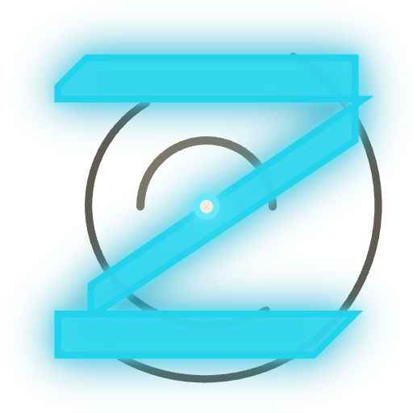

# FilterEngineZ — Brand Usage

Canonical mark, lockups, color treatments, and asset library. Everything in this folder is the **canonical brand asset
set**. Use these files; do not regenerate them by hand.

---

## The mark



A custom angular Z built from three parallelograms with **asymmetric chamfers** — 7u baseline cuts on the left side,
**10u flared cuts on the right side** — suggesting data flowing left-to-right through the filter stack. The Z is 70%
translucent so the three crescent arcs behind it interpenetrate visibly with its body. A glowing synapse node fires at
the center where the diagonal crosses the innermost arc.

The arcs are not closed circles. They are three crescents at offset angles — the outer opens right, the middle opens
left, the inner opens upward. This is the structural choice that dodges the "reticle / scope" reading that closed
concentric rings produce.

---

## Two presentation modes

| Mode                                                                                                                   | When to use                                                                                            | Files         |
| ---------------------------------------------------------------------------------------------------------------------- | ------------------------------------------------------------------------------------------------------ | ------------- |
| **Primary** — cyan body, 70% translucent fill, 1.6u solid cyan outline, layered drop-shadow neon, glowing synapse node | Dark surfaces (`--gray-0` / `--gray-1` backgrounds). 95% of usage.                                     | `*-primary.*` |
| **Subdued** — single-color mono `--gray-6` outline-only, no fill, no glow                                              | Light surfaces, print, embossing, single-color reproduction, contexts where the cyan glow would muddy. | `*-subdued.*` |

The two modes are **co-equal designs**, not "primary plus a desaturated fallback." Subdued was redrawn from scratch as
outline-only so it reads as considered in its own right.

```text
Decision rule:
  background luminance < 30%  → primary
  background luminance ≥ 30%  → subdued
  single-color print           → subdued
  the mark touches an image    → subdued (or extra-padded primary in a container)
```

---

## Canonical lockups

Four lockups cover every brand context. **Use these specifically**; don't invent new arrangements.

### D — Canonical primary

`svg/lockup-horizontal-primary.svg` · `svg/lockup-horizontal-subdued.svg`

The mark **replaces the Z** in the wordmark. Mark sits at ~88% of the wordmark's cap-height so its rings overshoot the
cap line just slightly — making the mark feel like a glyph that belongs _in_ the wordmark, not a stamp next to it. **Use
this everywhere the wordmark appears at a readable size.**

### E — Hero / display

For pages where the wordmark is the headline (landing page hero, documentation header, slide opener). Same geometry as
D, but **without rings** — the bare Z fills the cap height directly. Reach for E when the wordmark is at 44px or larger.

### A — Documentation / breathing-room

`LockupBeside` in `Lockups.jsx`

Mark beside the full text wordmark (with the Z rendered as an Orbitron glyph, not the mark). Use when the mark and the
wordmark each need to read as independent elements — README hero blocks, "About" pages, partner co-branding.

### Stacked

`svg/lockup-stacked-primary.svg` · `svg/lockup-stacked-subdued.svg`

Mark above the wordmark, centered. For square or portrait slots where a horizontal lockup would be too wide.

---

## Mark-in-circle

`svg/mark-in-circle-primary.svg` · `svg/mark-in-circle-subdued.svg`

For profile / avatar contexts (Twitter, GitHub avatars, Slack workspace icons). The mark is inset 22% from the circle's
edge so the rings have breathing room within the boundary. **Always use this variant** for circular contexts — never
crop a square mark into a circle programmatically.

---

## Asset inventory

```text
assets/logomark/
├── BRAND-USAGE.md              # this file
├── README.md                   # folder overview + quick start
├── showcase.html               # visual gallery of every asset
├── rasterize.html              # renders the lockups at exact export sizes for PNG capture
├── Mark.jsx                    # React component (canonical mark)
├── Lockups.jsx                 # React components (all lockups)
├── mark.css                    # Animation keyframes + lockup styles
├── site.webmanifest            # PWA manifest
├── browserconfig.xml           # Windows tile config
├── head-snippet.html           # <head> snippet to copy into apps
├── svg/                        # Vector sources — the canonical artifacts
│   ├── mark-primary.svg
│   ├── mark-subdued.svg
│   ├── mark-primary-animated.svg     # Standalone animated SVG (gentle breathing)
│   ├── favicon-primary.svg           # Z-only · no rings · favicon-class
│   ├── favicon-subdued.svg
│   ├── safari-mask-icon.svg          # Solid black silhouette
│   ├── lockup-horizontal-primary.svg # D · canonical
│   ├── lockup-horizontal-subdued.svg
│   ├── lockup-stacked-primary.svg    # stacked
│   ├── lockup-stacked-subdued.svg
│   ├── mark-in-circle-primary.svg    # Profile / avatar
│   ├── mark-in-circle-subdued.svg
│   ├── apple-touch-icon.svg
│   ├── icon-maskable.svg             # Full-bleed badge, mark inside the 80% safe circle
│   └── og-card.svg                   # 1200×630 OpenGraph card
├── png/                              # Rendered raster exports
│   ├── mark-primary-{8,12,16,32,64,128,192,512}.png
│   ├── mark-subdued-{8,12,16,32,64,128,192,512}.png
│   ├── favicon-{16,32,48,96}.png
│   ├── apple-touch-icon-180.png
│   ├── icon-192.png                  # PWA icon
│   ├── icon-512.png                  # PWA icon
│   ├── icon-512-maskable.png         # PWA maskable, from svg/icon-maskable.svg
│   ├── lockup-horizontal-{primary,subdued}.png
│   ├── lockup-stacked-{primary,subdued}.png
│   ├── mark-in-circle-{primary,subdued}-256.png
│   └── og-card.png                   # 1200×630
└── ico/
    └── favicon.ico                   # favicon-{16,32,48}.png in one ICO
```

`png/favicon-96.png`, `png/icon-512-maskable.png` and `ico/favicon.ico` are produced by
`node scripts/rasterize-brand-icons.mjs` from the repository root, from the vectors and PNGs listed beside them; its
`--check` flag confirms the committed files match a fresh render. The other PNGs are captures from `rasterize.html`.

---

## Animation

The mark has **one** canonical motion: a **gentle breathing pulse** on the center synapse node.

| Property         | Value                                       |
| ---------------- | ------------------------------------------- |
| Duration         | `2.4s` per cycle                            |
| Easing           | `ease-in-out`                               |
| Transform        | `scale(1) → scale(1.25) → scale(1)`         |
| Opacity          | `0.7 → 1.0 → 0.7`                           |
| Transform-origin | `50px 50px` (viewBox center)                |
| Reduced motion   | Animation removed, opacity locked at `0.85` |

```css
.fez-synapse-breathe {
  animation: fezBreathe 2.4s ease-in-out infinite;
  transform-origin: 50px 50px;
}
@keyframes fezBreathe {
  0%,
  100% {
    transform: scale(1);
    opacity: 0.7;
  }
  50% {
    transform: scale(1.25);
    opacity: 1;
  }
}
@media (prefers-reduced-motion: reduce) {
  .fez-synapse-breathe {
    animation: none;
    opacity: 0.85;
  }
}
```

**When to use the animation:**

- ✅ App header on initial load (play for 4–6 seconds, then settle to static-with-faint-breath)
- ✅ Loading / pending states inside the product
- ✅ Splash screens, splash modals
- ❌ Static documentation, social media images, print
- ❌ Anywhere that runs continuously (it should feel alive, not nervous)

Standalone animated SVG: `svg/mark-primary-animated.svg` — embed via `` or inline.

---

## Favicon set integration

Every site serves the set from its root, where browsers and search engines look for it: `/favicon.ico` is requested by
convention, and a search engine's favicon is the one the home page links. The files go flattened out of `svg/`, `png/`
and `ico/` under the names the snippet uses (`svg/favicon-primary.svg` → `favicon.svg`, `png/apple-touch-icon-180.png` →
`apple-touch-icon.png`; the rest keep their names). In this repository `@filter-enginez/brand` carries the set and
`node scripts/sync-brand-assets.mjs` copies it into every app. Then add this to your HTML `<head>`:

```html
<!-- One ICO with the 16, 32 and 48 px images, for every client that asks for /favicon.ico -->
<link rel="icon" href="/favicon.ico" sizes="16x16 32x32 48x48" />
<!-- Modern browsers: scalable SVG favicon, no font dependencies -->
<link rel="icon" type="image/svg+xml" href="/favicon.svg" />
<!-- PNG at every size a browser or a search engine asks for: multiples of 48 px for search results -->
<link rel="icon" type="image/png" sizes="16x16" href="/favicon-16.png" />
<link rel="icon" type="image/png" sizes="32x32" href="/favicon-32.png" />
<link rel="icon" type="image/png" sizes="48x48" href="/favicon-48.png" />
<link rel="icon" type="image/png" sizes="96x96" href="/favicon-96.png" />
<link rel="icon" type="image/png" sizes="192x192" href="/icon-192.png" />
<link rel="apple-touch-icon" sizes="180x180" href="/apple-touch-icon.png" />
<link rel="manifest" href="/site.webmanifest" />
<meta name="theme-color" content="#0B0A09" />

<!-- OpenGraph: an absolute URL, which social cards require -->
<meta property="og:image" content="https://filterenginez.com/og-card.png" />
<meta property="og:image:width" content="1200" />
<meta property="og:image:height" content="630" />
<meta name="twitter:card" content="summary_large_image" />
```

The complete snippet is in `head-snippet.html`. The manifest's `theme_color` and `background_color` are `--gray-0`, the
same as the `theme-color` meta tag, and its maskable icon keeps the whole mark inside the central circle of 80% diameter
that an Android launcher's mask always shows.

---

## Color tokens used

All colors come from `colors_and_type.css`. The mark uses:

| Token                  | Value     | Used for                            |
| ---------------------- | --------- | ----------------------------------- |
| `--gray-0`             | `#0B0A09` | Dark surface backdrop               |
| `--accent`             | `#22D3EE` | Mark fill + outline, primary mode   |
| `--accent-glow`        | `#67E8F9` | Synapse core, glow halo color       |
| `#0EA5C7`              | (literal) | Glow outer bloom color              |
| `#605C53`              | (literal) | Crescent arc stroke, primary mode   |
| `#7C7669`              | (literal) | Inner crescent stroke, primary mode |
| `--gray-6` (`#56524A`) |           | Mark stroke, subdued mode           |
| `#3A3731`              | (literal) | Crescent arc stroke, subdued mode   |

The two literal grays (`#605C53` and `#7C7669`) are between gray-6 and gray-7 in the system — they exist specifically so
the rings have enough presence to be visible behind the translucent Z without competing with the Z for attention. They
are mark-specific tokens; do not use them elsewhere in the UI.

---

## What NOT to do

| ❌                                                       | Why                                                               |
| -------------------------------------------------------- | ----------------------------------------------------------------- |
| Recolor the mark to anything other than cyan / mono-gray | The two presentation modes are the whole color system             |
| Place the primary mark on light backgrounds              | The glow muddies; use subdued                                     |
| Place subdued on dark backgrounds                        | It vanishes into the surface                                      |
| Use the wordmark in any font other than Orbitron 800     | Custom-paired typographic ratio; substitutes break it             |
| Crop the standalone mark to fit a circular container     | Use `mark-in-circle-*.svg` instead — it has correct inset         |
| Animate the mark globally (e.g., always-breathing)       | The breath is for moments, not perpetual                          |
| Tilt, skew, or rotate the mark                           | All decisions assume the canonical orientation                    |
| Add a tagline directly under the wordmark                | Use the OG card; in-product the wordmark stands alone             |
| Use the mark below 8px                                   | Below that, the Z's body breaks; use a text "Z" character instead |

---

## Refining or extending

The mark is parameterized in `Mark.jsx`:

```jsx
<FezMark size={64} mode="primary" noRings={false} animated={false} />
```

If you need a new size or treatment, **add it as a derived variant** in `Lockups.jsx` rather than passing custom props
through the call site. Concentrating variants in `Lockups.jsx` keeps the canonical mark API stable.

The Z geometry's chamfer and bevel depths are deliberately hard-coded in `Mark.jsx` (`buildCanonicalZ`). Adjusting them
means lifting them to constants at the top of the file — not exposing them as runtime props (the asymmetric 7u/10u
chamfers are part of the brand identity, not a knob).
